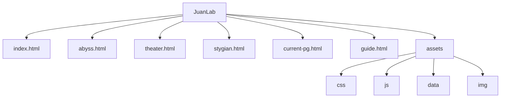

# JuanLab

[](https://juan0177.github.io/JuanLab/)
[](https://github.com/juan0177/JuanLab)

Sito personale pubblicato su GitHub Pages con tema dark, sfondo animato e contenuti organizzati in pagine dedicate.

Live: [https://juan0177.github.io/JuanLab/](https://juan0177.github.io/JuanLab/)

## ✨ Contenuti del progetto

Il sito include quattro sezioni principali:

- Guide (personaggi già usciti)
- Spyral Abyss
- Imaginarium Theater
- Stygian Onslaught

In più c'è una pagina nascosta con le guide dei personaggi ancora in beta: si apre con 5 click sul logo della home.

## 🧭 Pagine principali

- Home: `index.html`
- Guide: `guide.html`
- Guida generale alle build (Crit Value, Roll Value): `build-guide.html`
- Tools (calcolatore della build, semplice e avanzato): `tools.html`
- Spyral Abyss: `abyss.html`
- Imaginarium Theater: `theater.html`
- Stygian Onslaught: `stygian.html`
- Guide beta (nascosta, 5 click sul logo): `current-pg.html`

## 🌳 Struttura del progetto



## Dati endgame

I periodi di Spiral Abyss, Imaginarium Theater e Stygian Onslaught sono in `assets/data/<modalità>/`, elencati nel relativo `index.json`. Il sito mostra il periodo precedente, quello attuale e tutti quelli futuri (beta compresi). I periodi più vecchi sono archiviati in `assets/data/<modalità>/archive/`: il sito non li carica, ma si possono ripristinare.

## Avvio locale

Non è richiesto alcun build step. Il sito è statico e può essere visualizzato in locale in due modi:

### Con Live Server (VS Code)

1. Apri `index.html`
2. Fai clic destro
3. Seleziona "Open with Live Server"

### Con Python

```bash
python -m http.server 8080
```

Quindi apri `http://localhost:8080` nel browser.

> Nota: aprire i file direttamente con `file://` non è consigliato, perché i dati JSON vengono caricati tramite `fetch()`.

## Come aggiornare i contenuti

### Spyral Abyss

1. Crea o modifica un file nella cartella `assets/data/abyss/` (ad esempio `2026-08-16.json`)
2. Aggiorna `assets/data/abyss/index.json` con periodo e nome del file

Schema minimo:

```json
{
  "period": "Periodo live: 16 Agosto 2026 ~ 16 Settembre 2026",
  "gimmick": "Descrizione buff globale",
  "buff_first": "Descrizione buff prima meta",
  "buff_second": "Descrizione buff seconda meta",
  "slots": [
    {
      "slot": 1,
      "label": "Piano 12-1 Prima meta",
      "enemies": [
        { "id": "Fungus_Raptor", "level": 100, "hp": 1192502, "quantity": 1 }
      ]
    }
  ]
}
```

L'`id` del nemico deve corrispondere alla chiave usata dal progetto, derivata dalle icone in `assets/img/enemies/` e dal lookup in `assets/data/enemies.json`.

### Imaginarium Theater

1. Crea o modifica un file in `assets/data/theater/` (ad esempio `2026-09-01.json`)
2. Aggiorna `assets/data/theater/index.json`

Campi principali:

- `period`
- `fixed_buff`
- `mechanics` (`recommended_elements`, `opening_characters`, `guest_stars`)
- `selected_mode`
- `modes` (`lunar`, `visionary`, `hard`, `normal`, `easy`)
- `strategies`

Per avere la sezione Strategie presente ma vuota, usa:

```json
"strategies": []
```

Esempio di singola strategia:

```json
"strategies": [
  {
    "title": "Gestione energia",
    "points": [
      "Priorità ai personaggi con ricarica alta",
      "Conserva i personaggi di punta per gli atti boss"
    ]
  }
]
```

### Guide

- `guide.html` è la sezione pubblica, linkata dalla home: contiene solo le guide dei personaggi già usciti (tab "Guide attuali" e "Archivio").
- `current-pg.html` è la pagina nascosta (5 click sul logo della home): contiene solo le guide dei personaggi non ancora usciti, cioè in beta.
- Quando un personaggio esce, sposta la sua card da `current-pg.html` a `guide.html` e cambia il link "Torna a..." nella sua pagina.
- Gli stili di entrambe sono in `assets/css/current-pg.css`.
- `build-guide.html` è la guida generale alle build, linkata in "Guide generali". Gli screenshot sono in `assets/img/guides/build/` (ritagliati senza UID) e lo stile in `assets/css/build-guide.css`; il calcolatore sta in `tools.html`.
- Il calcolatore della build sta in `tools.html` (linkato dalla home e dalla guida), script `assets/js/build-calc-quick.js`. Al passo 4 si sceglie come inserire le statistiche: "Dalla schermata" (statistiche finali del personaggio) oppure "Dai 5 manufatti" (le secondarie di ogni pezzo; il calcolatore ricostruisce i totali da personaggio, arma, set e principali). Il report è lo stesso; con i manufatti in più c'è il pezzo da cambiare per primo. I dati sono in `assets/data/build-calc.json`: personaggi, armi (liv. 90) e set con i nomi italiani, generati da genshin-db, più le icone in `assets/img/calc/`. Il file contiene anche, scritti a mano, la statistica di danno dei personaggi (campo `s`) e i bonus al Tasso di CRIT dei set (`s2`, `c4`).
- "Cosa aumentare" stima quanto sale il danno medio con un roll medio (85% del massimo) di ogni statistica. Usa danno = statistica di danno × (1 + Tasso CRIT × DAN CRIT) × bonus della Maestria, con le formule di Genshin Optimizer: 1 + 25/9 × M / (M + 1400) con Vaporizzazione/Fusione, 1 + 6 × M / (M + 2000) con le reazioni Lunari e Stellari, nessun bonus con danno diretto e Congelamento. Per chi scala sulla Maestria, la Maestria è anche la statistica di danno. I bonus ai DAN della reazione dei set e del team non sono contati. Se manca Ricarica rispetto alla scheda del personaggio, la segnala per prima. Nella modalità "Dai 5 manufatti" ogni pezzo riceve un verdetto (Tieni, Valuta, Rimodella, Sostituisci) in base ai potenziamenti stimati sulle sue 2 secondarie utili migliori. Il confronto è con la garanzia della Polvere dell'illuminazione: almeno 2 potenziamenti, 3 con il rimodellamento Avanzato, 4 con il Decretato.
- In cima al calcolatore c'è "Importa dalla vetrina": si scrive un UID, si sceglie un personaggio e il calcolatore si compila (personaggio, arma, set, principali, pezzi, statistiche). Le vetrine vengono da Enka.network, che però non permette richieste dirette dal browser. Il sito cerca prima in `assets/data/showcase/<uid>.json` (vetrine salvate) e poi, se è configurato, nel proxy indicato in `data-enka-proxy` del modulo in `tools.html`. Il proxy è un Cloudflare Worker: codice e istruzioni in `tools/enka-proxy/`. `assets/data/enka-map.json` collega gli id dei personaggi di Enka a quelli del calcolatore (il Viaggiatore per elemento).
- Le icone delle statistiche in `assets/img/calc/stats/` vengono da lunaris.moe (icone del gioco). Il calcolatore le usa come maschera CSS, così prendono il colore del testo.
- `assets/data/character-builds.json` contiene la scheda di ogni personaggio, che il calcolatore semplice usa per dire cosa manca e cosa migliorare. Per ognuno: ruoli, statistica di danno, principali consigliate di Sabbie, Calice e Corona, priorità delle secondarie, Ricarica consigliata, Maestria (`maestria` = valore in schermata usato per il controllo, solo se una guida lo indica così; `maestria_team` = obiettivo delle guide in combattimento, spesso con i buff del team, solo informativo), nota, fonti e affidabilità (`alta` = KeqingMains più un'altra guida concordi). I codici delle statistiche sono atkp, hpp, defp, em, er, cr, cd, heal, dmg e phys. Per aggiornare un personaggio basta modificare il suo oggetto.

### Stygian Onslaught

1. Crea o modifica un file in `assets/data/stygian/`
2. Aggiorna `assets/data/stygian/index.json`

Campi principali:

- `version`
- `period`
- `description`
- `selected_difficulty`
- `overview`
- `difficulties`

Ogni difficoltà contiene un array `bosses`, e ogni boss usa `enemy_id` per recuperare nome e immagine da `assets/data/enemies.json`.

Schema minimo:

```json
{
  "version": "v6.7",
  "selected_difficulty": "6",
  "overview": {
    "title": "Panoramica rotazione",
    "description": "Note generali sulla rotazione",
    "points": []
  },
  "difficulties": {
    "6": {
      "label": "Difficoltà 6",
      "notes": "Focus generale",
      "bosses": [
        {
          "enemy_id": "Monitor_02",
          "hp": 14480438,
          "level": 100,
          "advantages": ["Cryo ed Electro"],
          "disadvantages": ["Personaggi melee"],
          "resistances": {
            "pyro": "10%",
            "hydro": "10%",
            "dendro": "10%",
            "electro": "10%",
            "anemo": "10%",
            "cryo": "10%",
            "geo": "10%",
            "physical": "10%"
          },
          "mechanics": [
            {
              "title": "Nome meccanica",
              "description": "Descrizione breve"
            }
          ]
        }
      ]
    }
  }
}
```

### Informazioni sui nemici

File: `assets/data/enemies.json`

Regole utili:

- `name` e icona devono essere coerenti
- `info` deve essere un array di stringhe
- se non hai consigli, usa `"info": [""]` oppure `"info": []`
- usa sempre doppi apici standard `"` (evita virgolette tipografiche)

## Deploy

```bash
git add .
git commit -m "Aggiornamento contenuti"
git push
```

GitHub Pages pubblica di solito entro 1-2 minuti.
